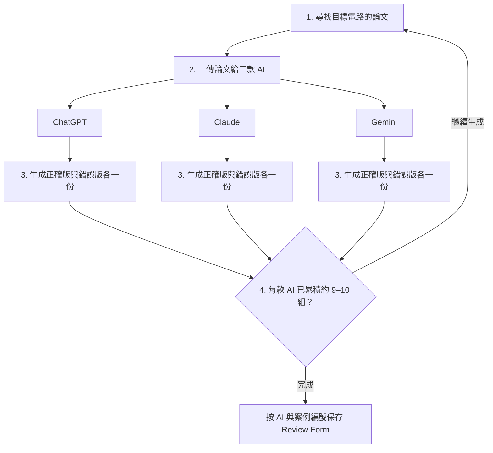

# Tapeout Review Form 文件

本目錄保存依論文生成的全客製 IC tapeout 審查表，供比較正確填寫方式與辨識錯誤。依資料提供者於 2026-10-16 補充的製作方式，使用 **ChatGPT、Claude、Gemini 三款 AI**，每款各生成約 **9–10 組案例**；每組要求一份正確版與一份刻意含錯誤版。

## 生成流程

正確版與錯誤版是生成時要求的目標類別；正確版仍需核對論文及工程證據。此流程說明審查表的製作方式，Netlist 的製作另見 [NotebookLM／Claude 迭代流程](../e516/00_Netlist_依電路分類/README.md#ai-生成與迭代流程)。

## 分類與現存案例

| 子目錄 | 生成方式 | 現存案例編號（依檔名，不含中繼資料） |
| --- | --- | --- |
| [ChatGPT](ChatGPT/README.md) | 依論文生成正確版及錯誤版 | `test`、`answer` 均有 1–10 |
| [Claude](Claude/README.md) | 依論文生成正確版及錯誤版 | `answer` 有 1–10；`test` 有 1、2、4–10，缺 3 |
| [Gemini](Gemini/README.md) | 依論文生成正確版及錯誤版 | `test`、`answer` 均有 1–10，部分編號未同時保存兩種格式 |

每款約 9–10 組是製作方式的說明；現存檔案以表列為準。PDF 與 Word 是檔案格式，不另計為新案例。保留原始 `test`／`answer` 命名，兩者與正確／錯誤內容的對應應以各份正文核對；不同 AI 的相同編號不保證對應同一電路。

## 閱讀方式

先選模型目錄，再按案例編號閱讀。正文包含電路概述、PVT、post-layout、power line、DRC／LVS 等項目。完整提示詞、生成對話及確切模型版本尚未附齊；文件中的模擬或通過敘述不是獨立驗證紀錄。

部分副檔名錯置，請查 [根目錄檔案清單](../HANDOFF_INVENTORY.csv) 的 `detected_format`，在工作副本上更正副檔名。AppleDouble 屬 macOS 中繼資料，不是 Word／PDF 正文。各模型 README 保留實際格式統計。

[回到 repository 總覽](../README.md)
