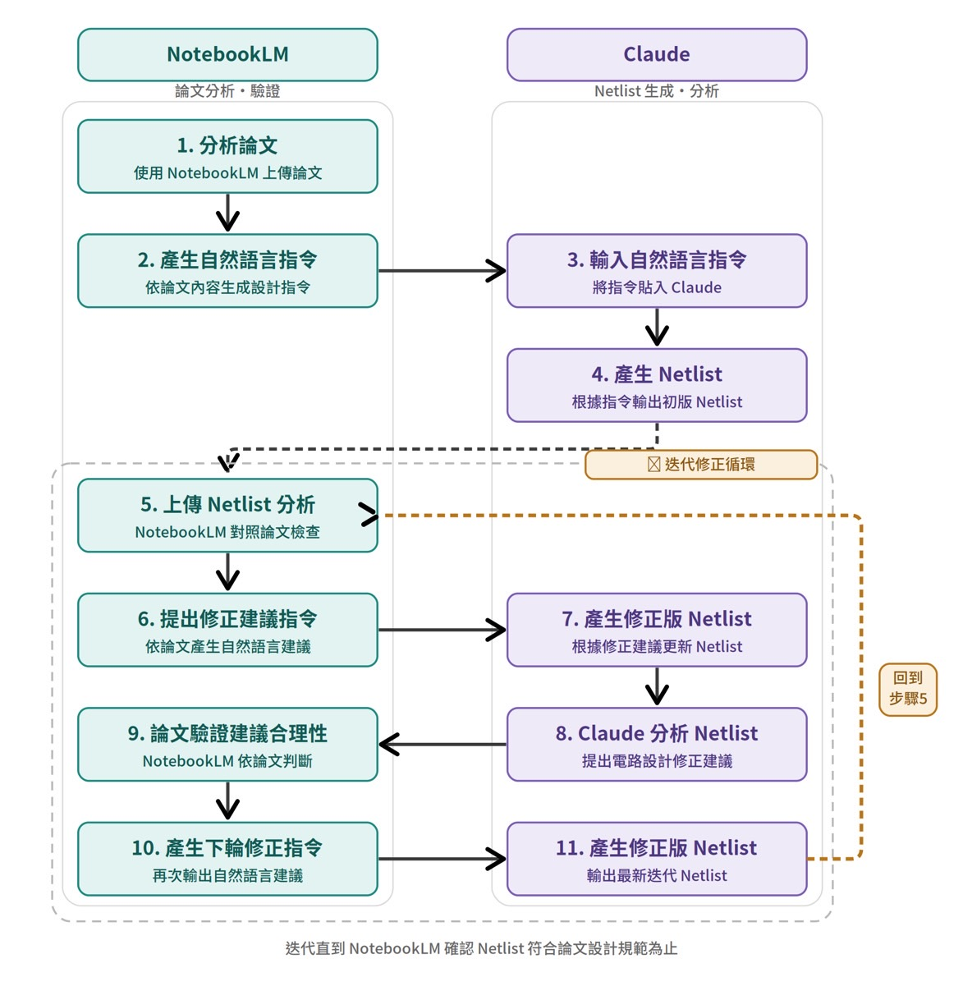

# Netlist 依電路分類

本目錄的 **Netlist 全部由 AI 生成**，包括標示 pre-layout、post-layout、fixed 或版本號的檔案。直接備份來源為提供者上傳的 `00_Netlist_依電路分類.zip`；原附索引與電路內容保留原貌。以下流程依資料提供者於 2026-10-16 的說明與附件補入。

## AI 生成與迭代流程

| 步驟 | 工具 | 工作內容 |
| --- | --- | --- |
| 1–2 | NotebookLM | 上傳並分析論文，依內容產生自然語言設計指令 |
| 3–4 | Claude | 輸入上述指令，生成初版 Netlist |
| 5–6 | NotebookLM | 上傳 Netlist，對照論文檢查並提出自然語言修正建議 |
| 7–8 | Claude | 依建議生成修正版，再分析 Netlist 並提出電路設計修正建議 |
| 9–10 | NotebookLM | 依論文判斷建議是否合理，再產生下一輪修正指令 |
| 11 | Claude | 輸出最新修正版 Netlist，回到步驟 5 |

反覆執行步驟 5–11，直到 NotebookLM 判斷 Netlist 符合論文設計規範。這是 AI 對照文獻的迭代檢查；實際模擬、版圖、DRC／LVS／PEX 的結果需另行取得。

附件原圖保存為 [netlist-generation-workflow.jpeg](netlist-generation-workflow.jpeg)。審查表的正確／錯誤版製作方式另見 [Tapeout Review Form 流程](../../Tapeout-Review-Form/README.md#生成流程)。

## 內容索引

| 分類 | 原始檔案數 | 用途 |
| --- | ---: | --- |
| [01_StrongARM比較器](01_StrongARM比較器/README.md) | 4 | StrongARM拓樸、平行放電路徑與testbench |
| [02_殘差放大器_Residue_Amplifier](02_殘差放大器_Residue_Amplifier/README.md) | 29 | NC／GAA及source-follower殘差放大器的版本鏈 |
| [03_Pipelined_SAR_DSM_ADC](03_Pipelined_SAR_DSM_ADC/README.md) | 4 | SAR＋增量DSM ADC與修正版 |
| [04_SAR_ADC](04_SAR_ADC/README.md) | 8 | SAR ADC、pre-layout與post-layout資料 |
| [05_ADC_SoC系統整合](05_ADC_SoC系統整合/README.md) | 4 | 5G與光通訊ADC SoC架構 |

另有原附 `README.txt`、[Netlist_電路分類表.md](Netlist_電路分類表.md) 與 `Netlist_電路分類表.xlsx`。原清單以32個「設計」條目列版本及testbench，不代表32個獨立且驗證完成的電路。49個電路／testbench檔中有18個 `.txt`，其中 `COMP_STRARM_core_Nparallel_auxgated_6nm.txt` 是唯一版本，其餘17份與相應SPICE檔完全相同，均保留原貌。

## 與 repo 舊分類的關係

2026-10-16 已刪除舊 `Netlist by AI/` 分類，只保留 e516 版本。移除前逐一比對44個電路／testbench檔的 Git blob SHA 與 SHA-256，均與本目錄檔案相同；舊 `20260605netlist.zip` 的3個正文檔也與本目錄 fixed／v2／v3 版本相同。舊分類的 README 隨舊目錄移除，可由 Git 歷史追溯。

本目錄另保有舊分類未包含的5個 A／B／C SAR ADC 檔。e516 內的各版本、副檔名副本及原始來源 ZIP 依原分類保留；testbench 與相依電路仍在同一層。

## 開啟與驗證

`.sp`、`.spice`、`.netlist` 與電路用 `.txt` 皆可用文字編輯器閱讀；分類表可用Markdown閱讀器及Excel／LibreOffice開啟。執行前核對模型與testbench，尤其40nm模型庫與先進節點PDK未包含於此包。

依提供者更正，所有 Netlist 均為 AI 生成。原附分類表及檔頭中的「Calibre xRC」「已抽取」「LVS clean」等為生成內容或歷史標籤，不能當作真實工具執行來源；目前未附可核對的版圖、抽取 log 或 LVS 報告。原表按原貌保留，Netlist 的實際製作方式以本 README 的流程說明為準。

[回到 e516 總覽](../README.md)
